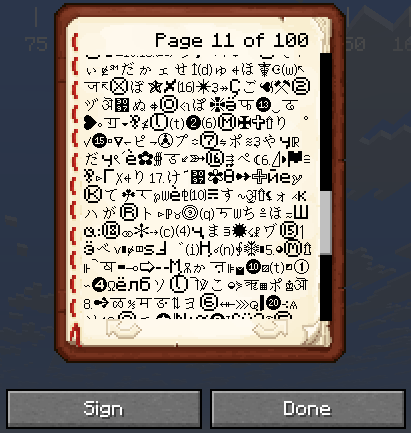

<h1 align="center">
BookFill Minecraft Exploit
</h1>
  

  

**Client-side only** Fabric mod. It works by sending the exact same network packet vanilla sends when you click "Done" / "Sign and Close" in the book-and-quill screen, so any server accepts it.   

Check out the [BookFill Minecraft Exploit Website](https://bookfill.hrasvx.dev/) for a tutorial.
## What it does

- `/bookfill <filename>` — reads `config/bookfill/<filename>.txt` and types
  it into the Book and Quill you're holding,
  splitting it into pages automatically. Book stays editable (not signed).
- `/bookfill <filename> <title...>` — same, but also **signs** the book.

- `/bookfill maxpages` — show the current page cap.
- `/bookfill maxpages <n>` — change it (1–5000). Persists across restarts
  in `config/bookfill/bookfill.properties`. **only singleplayer.**

## Raised per-page character limit

A `BookEditScreen` mixin raises the vanilla 1023-character-per-page cap in
the book editor to 32,000, so typing or pasting past the old limit works
in the GUI itself.

**Important**: this doesn't change what any server will accept. A page
this big can exceed a server's (or its anti-cheat plugin's) own size
limits and get rejected, truncated, or flagged.

## Usage

Put your `.txt` file(s) in `.minecraft/config/bookfill/`, e.g.
   `.minecraft/config/bookfill/example.txt`.
In-game: hold an empty Book and Quill, run `/bookfill example`.
